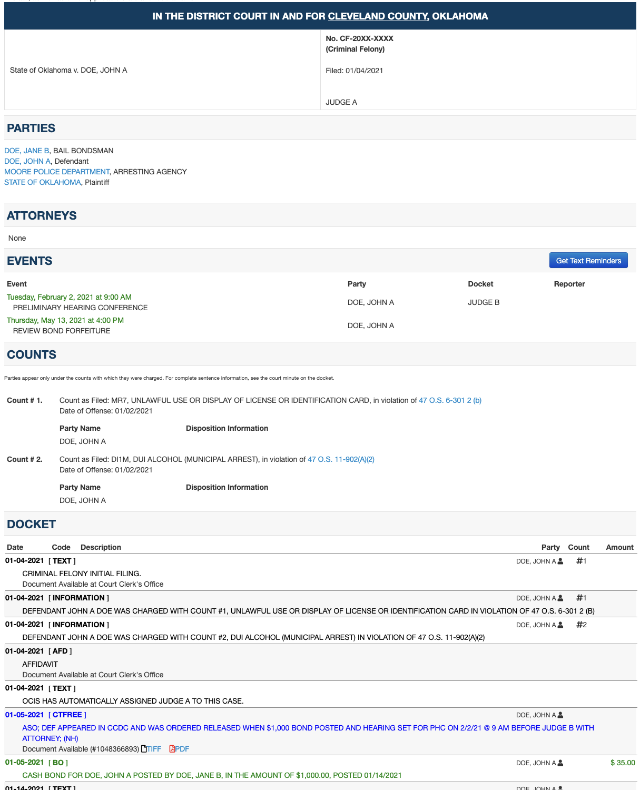

# The oscn-anonymizer tool
This is a little javascript tool to help you take screenshots of OSCN, replacing real peoples' names with "JOHN A DOE" style placeholders for privacy.

## How to install (Firefox): 

1. Open Firefox, go to `Bookmarks` > `Manage Bookmarks` > `Add Bookmark`
2. Name it "Redact OSCN" or whatever you want, 
3. Paste the whole contents of `redact-oscn.bookmarklet.txt` as its URL. 
   - That file is basically just `redact-oscn.js` squished down to one line.
4. Done!

If you're using chrome / safari / etc. I imagine it's a similar process. We could also turn this into a browser extension that should be more portable pretty easily I think.

## How to use: 

1. Open the OSCN case page. 
2. Click the bookmark, pick what to censor in the menu panel.
3. Click apply
4. Double check that it worked, then screenshot to your heart's content 

You can always refresh the page to make it look normal again.